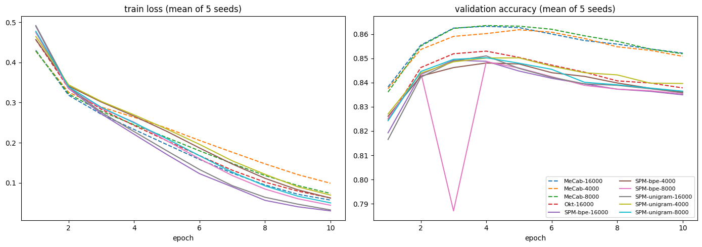
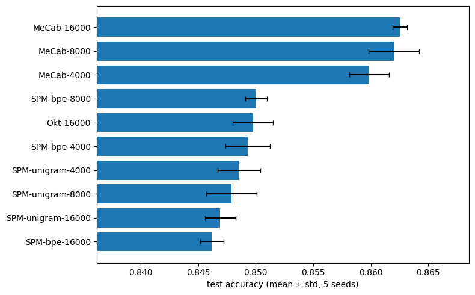
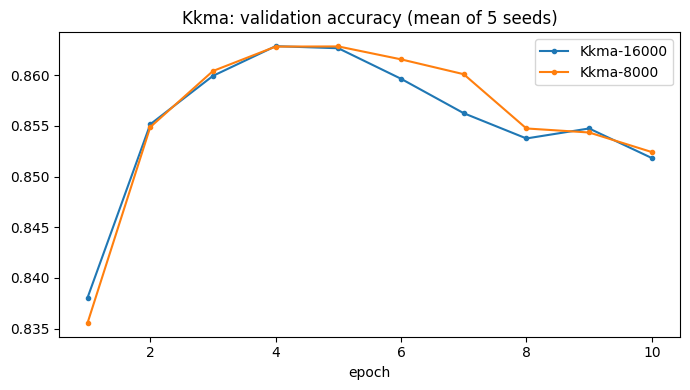
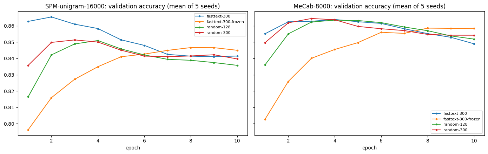
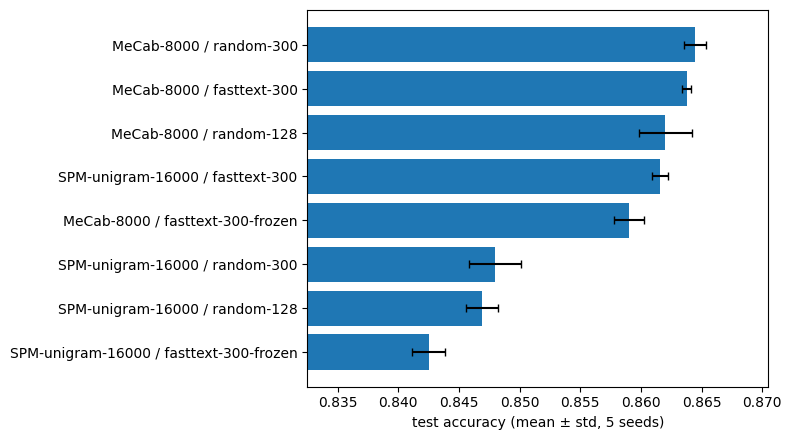

# 멋진 단어사전 만들기 — SentencePiece vs 형태소 분석기

네이버 영화리뷰(NSMC) 감정 분석에서 토크나이저를 SentencePiece로 바꾸면 성능이 좋아지는지 확인한 프로젝트다(NLP 과정 2. 멋진 단어사전 만들기, 5단계). SentencePiece(unigram/bpe × vocab 3종), MeCab(vocab 3종), Okt를 같은 BiLSTM 분류기로 비교했다.

## 실행 환경

- Google Colab Pro, A100 80GB, Python 3.13, PyTorch 2.11
- 원본 과제 코드에서 바꾼 곳은 `sp_tokenize()`의 한 줄뿐이다(list → tensor). 원본에 없는 셀은 제목에 `[개인 실험]`이라고 표시했다.
- 자세한 실행 기록은 `02_Sentiment_Analysis.ipynb`, 회고는 [report/개인회고.md](report/개인회고.md)에 있다.
- 코퍼스 분석 셀 2개(뉴스 말뭉치, Step 4-0 NSMC)는 Colab 실행 뒤에 추가해 로컬 PC(Python 3.10, pandas 2.3)에서 같은 데이터로 실행했다. GPU가 필요 없는 집계라 결과 숫자는 Colab에서 정제한 개수와 같다(76,908 / 146,182 / 49,157).

## 평가 기준 확인

| 평가 기준 | 확인할 곳 (`02_Sentiment_Analysis.ipynb`) |
|---|---|
| 코퍼스 분석, 전처리, SentencePiece 적용, 토크나이저 구현 및 동작 | 코퍼스 분석: 뉴스 말뭉치 → Step 2 SentencePiece 학습 → Step 3 `sp_tokenize()` → Step 4-0 NSMC 분석·정제 → [개인 실험] 1~2 NSMC용 SentencePiece 6개, 토큰화 예시, 토큰 통계 |
| SentencePiece 분류기가 수렴하고 test accuracy 80% 이상 | [개인 실험] 4·5: SentencePiece 6개 설정 모두 테스트 **0.846~0.850**. [개인 실험] 6: 러닝 커브(학습 loss 감소, 검증 정확도 3~5에폭 최고) |
| 다른 토크나이저·옵션과 체계적 비교 | [개인 실험] 5~9: MeCab·Okt 포함 10개 × 시드 5개, 같은 vocab 비교, MAX_LEN before/after, 오답 분석 / [추가 실험]: Kkma / [선택 과제]: fastText 사전학습 벡터(무작위·미세조정·고정) |

## 코퍼스 분석

| 코퍼스 | 원본 | 정제 | 최종 | 길이(평균 / 중앙값) |
|---|---|---|---|---|
| 뉴스 말뭉치 (SentencePiece Step 2) | 94,123문장 | 중복 16,532 / 10자 미만 197 / 150자 이상 486 제거 | 76,908문장 | 64.0자 / 62자 |
| NSMC 학습 | 150,000개 | 결측 5 / 중복 3,813 제거 | 146,182개 (긍정 49.8%) | 36.0자 / 27자 |
| NSMC 테스트 | 50,000개 | 결측 3 / 중복 840 제거 | 49,157개 (긍정 50.3%) | 35.8자 / 27자 |

- 뉴스 말뭉치의 중복은 `홍콩 닭장 아파트 생활`처럼 554번씩 반복된 기사 제목 조각이 대부분이다.
- NSMC는 라벨이 반반이라 정확도를 그대로 지표로 썼다. 긍정(35.4자)과 부정(36.5자)은 길이가 거의 같다.
- 공백 기준으로 세면 `영화.`, `영화를`, `영화는`이 따로 잡힌다. 같은 단어가 흩어지므로 형태소나 서브워드 토큰화가 필요하다.
- 학습과 테스트에 똑같은 리뷰가 796개(테스트의 1.6%) 있다. 과제 데이터 그대로 두었다.

## 결과 (NSMC 전체, 시드 5개 평균 ± 표준편차)

학습 131,564 / 검증 14,618 / 테스트 49,157. 설정과 에폭은 **검증으로만** 골랐고, 테스트는 모델마다 최고 검증 에폭의 모델로 한 번만 쟀다.

| 토크나이저 | 검증 정확도 | 테스트 정확도 | 최고 에폭 | `<unk>` 비율 |
|---|---|---|---|---|
| **MeCab-8000** | **0.8647 ± 0.0017** | 0.8620 ± 0.0022 | 4.2 | 4.6% |
| MeCab-16000 | 0.8640 ± 0.0024 | 0.8625 ± 0.0006 | 4.8 | 2.6% |
| MeCab-4000 | 0.8620 ± 0.0020 | 0.8599 ± 0.0017 | 5.0 | 7.8% |
| Okt-16000 | 0.8532 ± 0.0012 | 0.8498 ± 0.0017 | 3.8 | 8.1% |
| SPM-unigram-16000 | 0.8515 ± 0.0006 | 0.8469 ± 0.0013 | 3.8 | 0.1% |
| SPM-unigram-4000 | 0.8514 ± 0.0013 | 0.8486 ± 0.0018 | 3.6 | 0.1% |
| SPM-unigram-8000 | 0.8505 ± 0.0010 | 0.8479 ± 0.0022 | 3.8 | 0.1% |
| SPM-bpe-8000 | 0.8501 ± 0.0012 | 0.8500 ± 0.0009 | 3.4 | 0.1% |
| SPM-bpe-16000 | 0.8500 ± 0.0009 | 0.8462 ± 0.0010 | 3.6 | 0.1% |
| SPM-bpe-4000 | 0.8489 ± 0.0023 | 0.8493 ± 0.0019 | 4.4 | 0.1% |

## 한눈에 보기

| 질문 | 답 (근거) |
|---|---|
| SentencePiece로 바꾸면 좋아지나? | **아니다.** 같은 시드끼리 MeCab-8000이 SPM 최고(unigram-16000)보다 **1.51%p ± 0.22%p** 높았고, 시드 5개 모두 MeCab이 이겼다 |
| `model_type`, `vocab_size`는? | **거의 차이 없다.** SPM 6개 검증 평균이 0.26%p 안(0.8489~0.8515)으로, 시드 표준편차와 비슷하다 |
| v1의 "vocab이 크면 희귀 토큰 때문에 떨어진다"는? | **틀렸다.** 검증으로는 16000이 SPM 중 최고였고, 희귀 토큰(학습 5회 미만)은 SPM vocab의 0.05~0.85%뿐이다 |
| 차이는 어디서 오나? | `<unk>` 때문이 아니다. MeCab-4000은 `<unk>`가 7.8%인데도 SPM(0.1%)보다 1%p 넘게 높다. 어간과 어미를 나누는 방식 차이로 보인다 |
| 몇 에폭이 맞나? | **4~5에폭.** 그 뒤로는 학습 loss가 줄어도 검증 정확도가 떨어진다 |
| 60토큰에서 잘린 게 손해였나? | **거의 아니다.** MAX_LEN 128로 늘려도 검증 +0.04~0.14%p |
| [추가 실험] Kkma는? | **정확도는 MeCab과 거의 같다**(검증 0.8639). 대신 11프로세스 병렬로도 형태소 분석에 35.8분이 걸렸다(MeCab 13초) |
| [선택 과제] fastText 사전학습 벡터를 쓰면? | **SentencePiece만 크게 오른다**(+1.36%p, 테스트 0.8616). MeCab 수준까지 따라오고, MeCab은 거의 그대로다 |

## 개인 실험

| 궁금했던 점 | 방법 | 결과 |
|---|---|---|
| v1의 1%p 차이가 우연인가? | 토크나이저 10개 × 시드 5개(50회), 같은 시드끼리 차이 계산 | 1.51%p ± 0.22%p(시드별 1.13~1.69%p). 우연이 아니다 |
| 테스트로 고르면 부풀려지지 않나? | 학습에서 검증 10%(라벨 비율 유지)를 떼서 설정·에폭은 검증으로만 선택 | 검증 기준 최고 MeCab-8000 → 테스트 0.8620 ± 0.0022 |
| vocab 크기를 맞추면? | MeCab도 4000/8000/16000으로 SPM과 같은 크기로 비교 | 모든 크기에서 MeCab이 1.1~1.6%p 높음(테스트 평균) |
| 희귀 토큰 설명이 맞나? | vocab별 희귀 토큰 비율, `<unk>` 비율, 문장당 토큰 수, 잘리는 비율 집계 | SPM 희귀 토큰 0.05~0.85%로 설명이 틀림 |
| 4에폭이 적당했나? | 10에폭 동안 에폭마다 학습 loss와 검증 정확도 기록 | 최고 검증 에폭 3~6. 그 뒤로는 과적합 |
| 잘림이 손해였나? (before/after) | MAX_LEN만 60 → 128로 바꿔 시드 5개 재학습 | SPM-unigram-4000 +0.14%p, MeCab-8000 +0.04%p(검증). 원인 아님 |
| 다른 형태소 분석기는? | Okt 추가. Kkma는 느려서 [추가 실험]에서 병렬로 따로 실행 | Okt 검증 0.8532 ± 0.0012(분석 742초), Kkma-16000 검증 0.8639 ± 0.0019(11프로세스 35.8분), MeCab 분석 13초 |
| 무엇을 다르게 틀리나? | 한쪽만 맞힌 테스트 리뷰를 토큰화 결과와 나란히 보고, 길이별 정확도 비교 | MeCab만 맞힘 7.1%, SPM만 맞힘 5.4%. 모든 길이 구간에서 MeCab이 1.2~1.9%p 높음 |

## [추가 실험] Kkma 형태소 분석기

과제 안내의 "Mecab, kkma, Okt 등과 비교"에서 빠졌던 Kkma를 같은 조건(같은 분할, BiLSTM, 시드 5개)으로 따로 돌렸다. Kkma는 느려서 CPU 12코어 중 11개에 Kkma를 하나씩 띄워 병렬로 분석했다.

| 토크나이저 | 검증 | 테스트 | 문장당 토큰 | 형태소 분석 시간 |
|---|---|---|---|---|
| MeCab-8000 | **0.8647 ± 0.0017** | 0.8620 ± 0.0022 | 18.7 | 13초 |
| Kkma-16000 | 0.8639 ± 0.0019 | 0.8616 ± 0.0009 | 20.3 | 2,150초 (11프로세스) |
| Kkma-8000 | 0.8639 ± 0.0020 | 0.8607 ± 0.0020 | 20.3 | 〃 |
| Okt-16000 | 0.8532 ± 0.0012 | 0.8498 ± 0.0017 | 14.7 | 742초 |
| SPM-unigram-16000 | 0.8515 ± 0.0006 | 0.8469 ± 0.0013 | 15.4 | 6개 합계 96초 |

- **정확도는 MeCab과 거의 같다**(검증 0.08%p 차이, 시드 표준편차보다 작음). Okt·SentencePiece보다 1%p 넘게 높다.
- **대신 아주 느리다.** 한 프로세스 기준 1개당 23.7ms(전체 약 77분, MeCab의 약 356배)다. 11프로세스로 병렬로 돌렸는데도 35.8분이 걸렸다. 예상(7분)보다 5배 느렸고, 중간에 10분 넘게 멈춘 구간이 있었다(원인은 확인하지 못함).
- **어디서 나누는지가 중요해 보인다.** 어간과 어미를 떼는 MeCab·Kkma는 0.864 근처다. 붙여 두는 Okt(`버텼다`)와 SentencePiece는 0.85 근처다. SPM-unigram-4000도 문장당 20.2토큰으로 Kkma만큼 잘게 나누지만 0.8514에 그쳤다. 토큰 수보다 형태소 경계에서 나누는지가 차이를 만든 것으로 보인다(모델 하나로 본 상관관계).

## [선택 과제] fastText 사전학습 단어 벡터

5단계 과제 안내의 선택 항목이다. 임베딩을 fastText 한국어 벡터(`cc.ko.300`)로 시작하면 성능이 오르는지 확인했다. 데이터 분할과 토크나이저는 위와 같고, v2 설정(`random-128`)을 다시 돌려 시드별 숫자까지 똑같이 재현되는 것을 먼저 확인했다. 차원 효과와 구분하려고 300차원 무작위 임베딩을 대조군으로 두었다.

| 토크나이저 | random-128 (v2) | random-300 | fasttext-300 (미세조정) | fasttext-300 (고정) |
|---|---|---|---|---|
| MeCab-8000 (테스트) | 0.8620 ± 0.0022 | **0.8645 ± 0.0009** | 0.8638 ± 0.0004 | 0.8590 ± 0.0012 |
| SPM-unigram-16000 (테스트) | 0.8469 ± 0.0013 | 0.8480 ± 0.0022 | **0.8616 ± 0.0007** | 0.8425 ± 0.0014 |
| SPM-unigram-16000 (검증) | 0.8515 ± 0.0006 | 0.8519 ± 0.0029 | **0.8654 ± 0.0006** | 0.8479 ± 0.0021 |

- **SentencePiece만 크게 올랐다.** 300차원 무작위보다 같은 시드끼리 테스트 +1.36%p ± 0.27%p였고, 시드 5개 모두 올랐다. 검증 0.8654는 8개 설정 중 가장 높다.
- **MeCab은 거의 그대로다**(-0.07%p ± 0.07%p).
- **그래서 결론이 달라진다.** 무작위 임베딩에서는 MeCab이 1.5%p 앞섰지만, fastText로 시작하면 SentencePiece가 MeCab 수준까지 따라온다. 검증 기준으로는 MeCab random-300(0.8649)과 0.05%p 차이로 사실상 동률이다.
- **벡터를 고정하면 둘 다 약 0.5%p 떨어진다.** `노잼`과 가장 가까운 이웃이 `꿀잼`일 만큼 반대 감정 단어도 가깝게 붙어 있어서, 미세조정이 필요하다.
- 왜 SentencePiece만 덕을 봤는지는 아직 확인하지 못했다. 어절에 가까운 조각(`▁영화가`)이 fastText 학습 단위와 맞았기 때문이라고 추측한다.

## 원본 코드에서 바꾼 곳

| 원본 | 바꾼 코드 | 이유 |
|---|---|---|
| `tensor.append(s.EncodeAsIds(sen))` | `tensor.append(torch.tensor(ids, dtype=torch.long))` | `pad_sequence`는 tensor만 받는다. 원본 그대로면 `TypeError` |
| `open(..., 'w')`, `open(vocab_path, 'r')` | `encoding='utf-8'` 추가 | 한글 파일을 환경에 상관없이 같은 인코딩으로 읽고 쓰려고 |
| (없음) | `max_len` 인자 추가 | 실험에서 문장 길이를 자르려고 |

## 파일 구성

| 파일 | 설명 |
|---|---|
| [`02_Sentiment_Analysis.ipynb`](02_Sentiment_Analysis.ipynb) | **최종 정리본** — 원본 과제 + 개인 실험, 실행 결과 포함 |
| [`SentencePiece_추가실험_Kkma.ipynb`](SentencePiece_추가실험_Kkma.ipynb) | [추가 실험] Kkma만 따로 실행한 노트북(같은 내용이 v2에도 들어 있음) |
| [`SentencePiece_선택과제_fastText.ipynb`](SentencePiece_선택과제_fastText.ipynb) | [선택 과제] fastText만 따로 실행한 노트북(같은 내용이 v2 끝에도 들어 있음) |
| [`report/개인회고.md`](report/개인회고.md) | 막혔던 부분과 해결, 알게 된 것, 개인 실험 요약, 회고 |
| [`report/images/`](report/images) | 러닝 커브, 테스트 정확도 그래프 |
| [`SentencePiece_프로젝트_v1.ipynb`](SentencePiece_프로젝트_v1.ipynb) | v1(참고) — 샘플 6만/2만, 시드 1개, 테스트로 비교. 회고의 vocab·희귀 토큰 해석은 v2에서 틀린 것으로 확인됨 |
